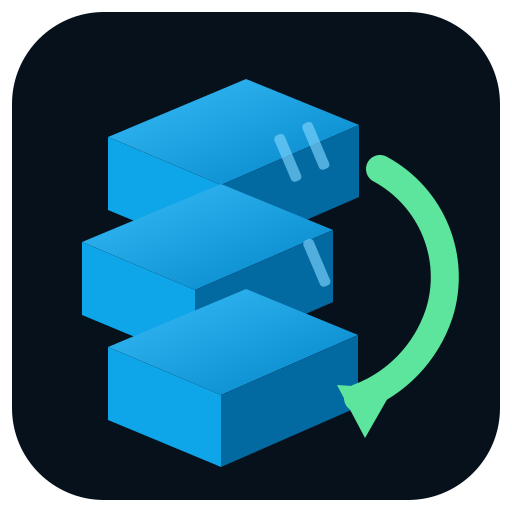
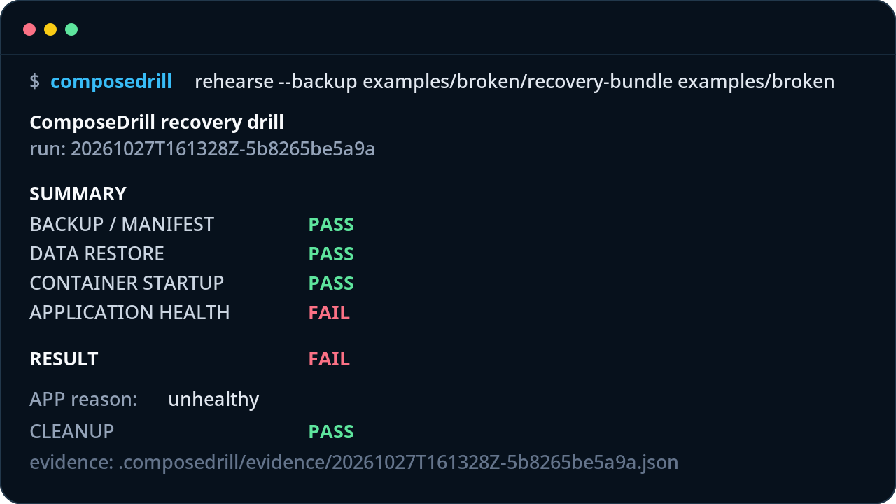

<p align="center">
  
</p>

# ComposeDrill

**Your backup passed. Will your app?**

ComposeDrill restores a Docker Compose workload into an isolated rehearsal environment, restores persistent state, starts the stack, and runs real health checks. If the application does not come back, the drill fails.

**Production data paths stay untouched.** ComposeDrill writes only its own `.composedrill/` workspace beneath the rehearsal root and creates disposable, run-labeled Docker resources for the drill.



```text
BACKUP / MANIFEST        PASS
DATA RESTORE             PASS
CONTAINER STARTUP        PASS
APPLICATION HEALTH       FAIL

RESULT                   FAIL
```

**A backup existing is not proof that the application is recoverable.**

ComposeDrill is a recovery-rehearsal CLI. It is not a backup scheduler, storage backend, Docker dashboard, or Restic/Kopia replacement.

## Why backup verification is not enough

A backup job can finish successfully while recovery is still broken:

- a persistent path was never included;
- a database dump exists but is unusable;
- a required `.env`, secret, or config is absent;
- a mutable image tag now resolves to something different;
- a container starts but the application is unhealthy;
- the restore procedure depends on undocumented manual steps.

ComposeDrill asks the next question: **can this Compose application be reconstructed from the supplied recovery bundle and prove that it works?**

## Quick start

### Install a release binary

Download the archive for your platform from GitHub Releases, verify it against `checksums.txt`, then install the `composedrill` binary somewhere on your `PATH`.

macOS arm64 example:

```bash
ARCHIVE="composedrill_0.1.0-preview_darwin_arm64.tar.gz"

grep "$ARCHIVE\$" checksums.txt | shasum -a 256 -c -

tar -xzf "$ARCHIVE"

mkdir -p "$HOME/.local/bin"
install -m 0755 composedrill "$HOME/.local/bin/composedrill"

"$HOME/.local/bin/composedrill" version
```

Or build from source with Go 1.23+:

```bash
go build -trimpath -buildvcs=false -o composedrill ./cmd/composedrill
```

Then:

```bash
# Read-only inventory and readiness findings
composedrill scan ./homelab

# Read-only human recovery plan
composedrill plan ./homelab

# Portable facts about current Compose state
composedrill manifest --output recovery-manifest.json ./homelab

# Validate the bundle and preview the drill
composedrill rehearse --backup ./recovery-bundle --dry-run ./homelab

# Run the isolated recovery rehearsal
composedrill rehearse --backup ./recovery-bundle ./homelab
```

`scan`, `plan`, and `manifest` are read-only. `rehearse` requires Docker Compose v2 and a running Docker daemon.

## How a drill works

```text
backup + checksummed manifest
            |
            v
   validate declared inputs
            |
            v
  rewrite into a random run namespace
            |
            v
 restore binds / volumes / databases
            |
            v
       start containers
            |
            v
 Docker health + explicit checks
            |
            v
       PASS / FAIL / MANUAL
            |
            v
       evidence + cleanup
```

For HTTP and TCP checks, ComposeDrill does **not** publish recovery services back onto host ports. It runs a constrained, tool-owned probe container on the verified internal recovery network.

A running container is not automatically a successful recovery. Startup and application health are reported separately.

## Supported persistence and recovery types

| Recovery path | v0.1.0-preview status |
| --- | --- |
| Bind mounts | Supported: directory, `.tar`, `.tar.gz`/`.tgz` |
| Named volumes | Supported: tar archive into a disposable volume; real-Docker gated |
| Anonymous volumes | Supported when explicitly mapped by service + target; real-Docker gated |
| PostgreSQL plain SQL | Supported; real-Docker gated with restored-row assertion |
| PostgreSQL custom format | Implemented; not independently real-Docker gated |
| MariaDB logical SQL | Supported; real-Docker gated with restored-row assertion |
| MySQL logical SQL | Implemented through the same `mysql-sql` path; not independently real-Docker gated |
| SQLite | Supported restore path; source capture must use SQLite-safe backup semantics |

Health verification supports active Docker healthchecks plus explicit HTTP, TCP, command, file-exists, and DNS checks. See [`docs/SUPPORT_MATRIX.md`](docs/SUPPORT_MATRIX.md) for the exact evidence boundary.

## Safety model

The default posture is refusal over cleverness.

- Production Compose projects are never brought down.
- Production named volumes are never restore targets.
- Production bind sources are replaced with run-local paths.
- Recovery services publish no host ports.
- Recovery networks are rewritten as `internal: true`.
- Run resources use random project names plus ownership labels.
- Cleanup deletes only resources whose namespace and ownership labels match the drill.
- Privileged/device/GPU access, custom runtimes, namespace/cgroup sharing, capability additions, `extra_hosts`, external links, service `security_opt`, host-capable volume/network driver settings, and unknown mount types are refused for automatic rehearsal.
- External secret/config objects and undeclared host-file inputs are refused.
- Tar extraction rejects traversal, links/symlinks, and special files.
- Unmapped persistent data becomes `MANUAL CHECK REQUIRED`, never `PASS`.
- Cleanup failure forces the overall drill to fail.

Docker is still not treated as a hardened security sandbox. Untrusted images belong on a dedicated host or VM.

Read [`docs/SAFETY.md`](docs/SAFETY.md) and [`docs/THREAT_MODEL.md`](docs/THREAT_MODEL.md) before using `rehearse` on an important host.

## Known limitations

The limits are part of the product contract, not footnotes:

- Docker Compose only; no Swarm, Kubernetes, VM, or orchestration-specific recovery.
- Compose profiles are not activated automatically; profile-gated services remain manual.
- Docker internal networking reduces exposure but is not a hardened sandbox.
- Archive validation does not yet impose a global entry-count or expanded-byte quota.
- Directory-form bundles have a documented validation/use TOCTOU boundary.
- Manifests and evidence are checksummed but not cryptographically signed.
- PostgreSQL custom-format and MySQL logical restore paths are implemented but not independently real-Docker gated in v0.1.
- DNS checks and scaled-service aggregation do not yet have dedicated real-Docker fixtures.
- Several synthetic fixture service images use mutable version tags; the scanner flags them as such.

See [`docs/KNOWN_LIMITATIONS.md`](docs/KNOWN_LIMITATIONS.md) for the full list.

## Evidence and report format

A drill writes machine-readable evidence under:

```text
.composedrill/evidence/<run-id>.json
```

The report records the run namespace, Compose and bundle hashes, per-service configuration/data/startup/health states, explicit check results, findings, cleanup state, and tool version. Evidence redaction covers common secret assignments and URL credentials, but it is defense-in-depth rather than a general DLP system.

The repository also includes [`docs/SAMPLE_RECOVERY_REPORT.json`](docs/SAMPLE_RECOVERY_REPORT.json).

## Installation and releases

Official preview archives are built as static Go binaries for:

- macOS arm64
- macOS amd64
- Linux amd64
- Linux arm64

The release workflow runs unit tests, race tests, vet, a production build, and the Docker integration suite before GoReleaser publishes archives and `checksums.txt`. The final v0.1.0-preview release gate has been run on macOS arm64 with Docker Desktop; other packaged architectures are build targets and must not be read as equivalent real-Docker platform evidence.

See [`docs/INSTALL.md`](docs/INSTALL.md) and [`docs/DOCKER_VALIDATION.md`](docs/DOCKER_VALIDATION.md).

## Contributing

The most useful contribution is a recovery fixture for a real self-hosted stack:

> **Add a recovery fixture for a real self-hosted stack.**

A fixture should contain only synthetic/non-secret data and must prove something meaningful about recovery. It needs:

1. a minimal Compose file that represents the persistence pattern;
2. a checksummed recovery bundle;
3. a documented application-consistent backup method;
4. at least one check that proves restored state, not merely process startup;
5. an expected success or intentional-failure outcome;
6. cleanup/isolation assertions where new Docker resources are introduced.

See [`CONTRIBUTING.md`](CONTRIBUTING.md) and the **Application recovery fixture** issue template.

## Technical and security docs

- [Architecture](docs/ARCHITECTURE.md)
- [Backup/recovery semantics](docs/BACKUP_RECOVERY_SEMANTICS.md)
- [Safety model](docs/SAFETY.md)
- [Threat model](docs/THREAT_MODEL.md)
- [Support matrix](docs/SUPPORT_MATRIX.md)
- [Known limitations](docs/KNOWN_LIMITATIONS.md)
- [Release validation](docs/DOCKER_VALIDATION.md)
- [Roadmap](docs/ROADMAP.md)

License: Apache-2.0.
